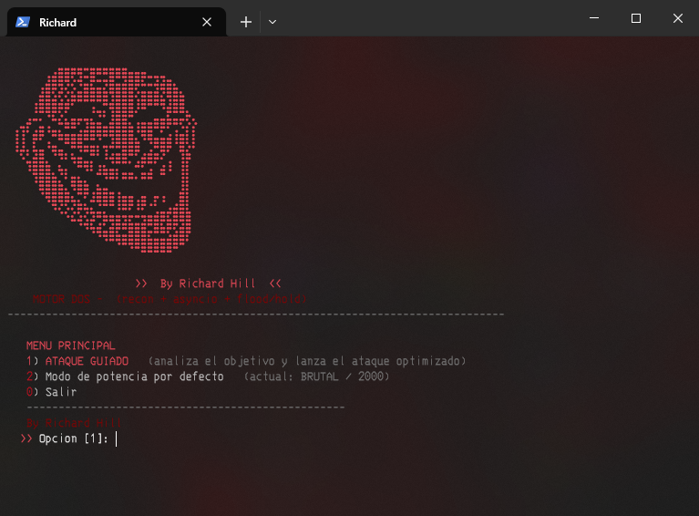

# Herramienta en Python (Versión Mejorada V2)

> **Actualización:** Versión optimizada con análisis avanzado y mayor letalidad.

## 📸 Vistas Previas

### Foto 1 (Interfaz Original / Base)


### Foto 2 V2 (Versión Mejorada)


---

## ⚙️ Entorno y Requisitos
* **Entorno:** Probada en Windows 10.
* **Aviso:** Si experimenta errores, asegúrese de instalar los requerimientos necesarios.

## 💻 Ejecución
```bash
python dos.py
